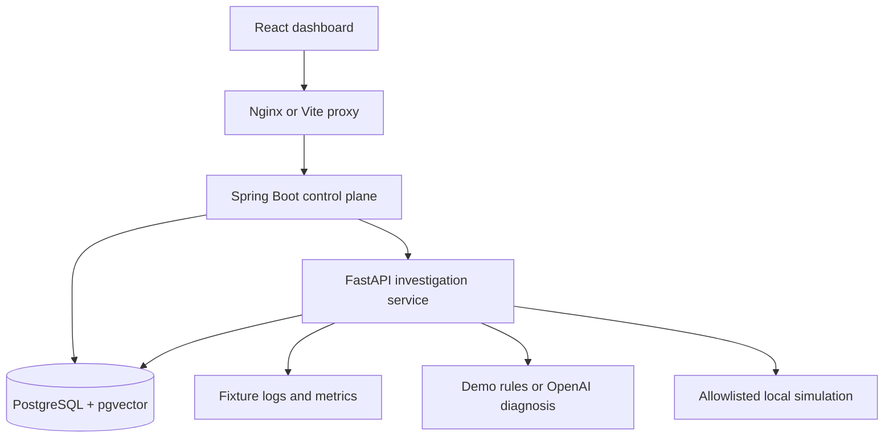
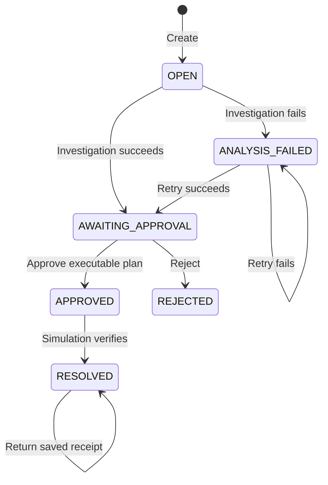

# End-to-end architecture

Current implementation, updated 2026-10-15. Product scope: [PRD.md](PRD.md). Detailed routes and payloads: [API.md](API.md).

## Components and entry points

| Component | Responsibility | Code to inspect |
| --- | --- | --- |
| React/TypeScript | Queue, investigation, decisions, evidence, audit, runbook form | `frontend/src/App.tsx`, `frontend/src/api.ts` |
| Local proxy | Forward `/api` and supply backend bearer token | `frontend/nginx.conf.template`, `frontend/vite.config.ts` |
| Spring Boot | API validation, lifecycle transitions, persistence, approval, audit | `backend/src/main/java/ai/opspilot/Api.java`, `IncidentService.java` |
| Java agent client | Authenticated synchronous calls to Python | `backend/src/main/java/ai/opspilot/AgentClient.java` |
| FastAPI | Investigation/ingestion/execution endpoints and agent token check | `ai-service/app/main.py`, `models.py` |
| Retrieval/provider layer | Chunking, embeddings, vector search, structured diagnosis | `ai-service/app/retrieval.py`, `embeddings.py`, `reasoning.py` |
| Mock tools | Fixture evidence and bounded simulation outcomes | `ai-service/app/tools.py`, `fixtures/incidents.json` |
| Database migrations | All schema creation, including vector extension | `backend/src/main/resources/db/migration/V1__schema.sql` |

React production builds use `tsc` plus `frontend/build.mjs` (esbuild). Vite serves development and configures Vitest. Production static assets are served by Nginx.

## Startup and local connectivity

Compose startup order: PostgreSQL health → Spring/Flyway migrations and health → Python runbook seeding and health → frontend. FastAPI does not own a second migration system.

| Service | Compose address | Host entry |
| --- | --- | --- |
| Dashboard | `frontend:80` | `http://localhost:3000` |
| Java API | `backend:8080` | `http://localhost:8080`; Swagger at `/swagger-ui/index.html` |
| Python | `agent:8000` | Internal only in Compose; native development uses port 8000 |
| Database | `postgres:5432` | localhost:5432; named volume persists data |

Host bindings use `127.0.0.1`. The dev dashboard uses port 5173. Compose reads root `.env`; native processes need environment variables exported explicitly. Settings and startup commands are in the root [README](../README.md).

## Investigation request

1. Browser sends `POST /api/incidents` with `service`, `title`, `description`, `severity`, and optional `scenarioId`. Java validates scenario/service correspondence, persists OPEN, and audits creation.
2. `POST /api/incidents/{id}/analyze` locks the incident row and permits OPEN or ANALYSIS_FAILED only.
3. Java calls Python `/v1/analyze` with `incident_id`, `service`, `description`, and `scenario_id`. The camelCase creation field becomes snake_case in the internal contract.
4. Python collects fixture logs and metrics, embeds the query, and retrieves runbook chunks. Matching fixture evidence plus its expected retrieved runbook makes a proposal executable.
5. Demo mode returns the fixture hypothesis; OpenAI mode requests schema-validated diagnosis text. Evidence/runbook IDs from the model must belong to the supplied context.
6. Java stores analysis JSONB, sets AWAITING_APPROVAL, and appends an event. The dashboard renders the result and its citations.

Analysis includes `mode`, `root_cause`, `reasoning`, `confidence`, `evidence`, `citations`, `recommendation`, `tool_calls`, and `warnings`. The model does not choose arbitrary executable tools.

## Approval and execution

Java accepts one decision with a nonblank reviewer and note. It blocks approval if `executable=false`. Analysis cannot be changed after reaching AWAITING_APPROVAL.

Execution loads the saved APPROVE record and sends incident UUID, approval UUID, service, scenario, and action to Python. Python independently checks the persisted decision/status and exact approved context, then enforces the fixture action allowlist. It returns simulated before/after metrics and a stable receipt. Java stores one execution and one execution event and marks RESOLVED. A failed execution leaves APPROVED through transaction rollback. Rejected incidents cannot execute or reopen.

## Retrieval and data ownership

Runbooks split at 180 words with 30-word overlap. Chunk embeddings have 1536 dimensions and a model tag. Query embeddings use description plus evidence. Exact pgvector cosine search filters by service/model and returns up to three chunks; no approximate index is required at this dataset size.

Demo uses `demo-hash-v1` lexical vectors. OpenAI uses the configured semantic embedding model at 1536 dimensions. Switching modes reindexes built-in runbooks at startup; custom procedures must be reingested for the active model. Custom IDs cannot start with `rb-`.

| Tables | Data owner |
| --- | --- |
| `services`, `incidents`, `approvals`, `executions`, `audit_events` | Spring Boot |
| `runbooks`, `runbook_chunks` | FastAPI writes; Flyway owns schema |

UUIDs identify incidents/approvals; JSONB stores analysis, audit details, and simulation results. Unique approval/execution constraints and incident row locks protect transitions.

## Failure and trust boundaries

- Java uses a 5-second connect timeout and 60-second read timeout for Python. Provider embedding/diagnosis calls have 40/45-second timeouts; combined work can exceed Java's deadline. See [Tasks.md](Tasks.md) for follow-up.
- Analysis errors persist ANALYSIS_FAILED with a generic error and retryable event. The analyze API returns the incident with HTTP 200; inspect its status.
- Other invalid transitions return 409. More status details are in [API.md](API.md).
- Browser proxy supplies API_TOKEN; Python requires AGENT_TOKEN. These are local service controls, not authenticated human identity.
- Retrieved text, incident descriptions, and logs are untrusted data. Reference validation does not prove semantic correctness.
- Synchronous external calls occur inside Java transactions. There is no durable queue, checkpointed planner, or guarantee of exactly-once real-world effects.

The ten scenario IDs are `db-pool`, `bad-release`, `oom`, `cpu`, `disk`, `redis`, `kafka`, `certificate`, `dns`, and `rate-limit`. Their procedures live in `fixtures/runbooks.json`. All telemetry and remediation are simulated.
