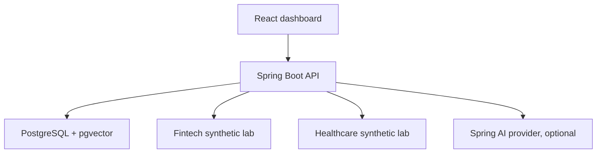
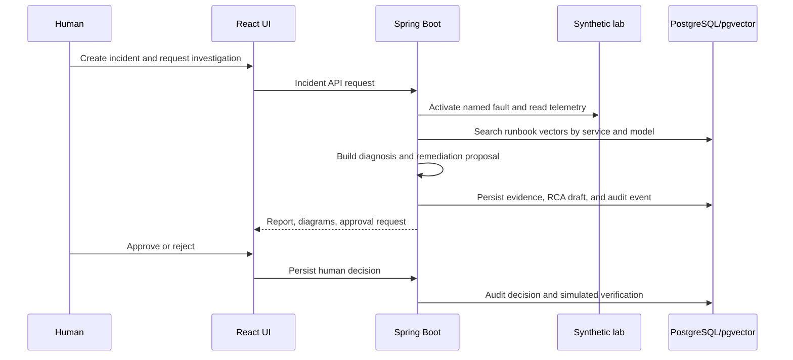

# Architecture

## Runtime topology

Compose starts PostgreSQL, two isolated fintech/healthcare labs, a cooperating e-commerce cluster (storefront, checkout, inventory, traffic generator, telemetry/fault controller), Spring Boot, and the frontend. The test profile runs lab tests plus black-box API regressions against the same stack.

## Investigation flow

## Components
| Component | Responsibility |
|---|---|
| `Api.java` | Bearer-protected incidents, runbooks, configuration items, problem/change records, and RCA review |
| `IncidentService` | Incident state machine, ticket metadata, orchestration, approval checks, simulation, audit, RCA draft creation |
| `AgentClient` | Spring AI adapter, deterministic embeddings/diagnosis, OpenAI embeddings/chat, pgvector SQL search, allowlisted simulated outcomes |
| `LabClient` | Select lab by scenario, activate only allowlisted faults, fetch collected telemetry |
| `ItsmService` | CI inventory, linked problem/change records, guarded change transitions, RCA review and RAG promotion |
| `lab/app.py` | Synthetic HTTP workload, fault controls, logs, metrics, domain endpoints |
| `lab/commerce_lab.py` | E-commerce storefront, checkout, inventory, background order worker, traffic generator, and telemetry/fault controller (`ROLE`) |
| PostgreSQL/Flyway | Ticket and workflow records, JSON evidence, audit, runbooks and 1536-dimension vector chunks |
| React | Light dashboard for queue, report, evidence, approval/rejection, runbooks and audit history |

## Storage and RAG
`V1__schema.sql` creates incident/workflow/runbook schema and pgvector. `V2__itsm_records.sql` adds ITIL fields, CIs, problem/change tables, links, and RCA records. Flyway owns schema changes.

Runbooks are split into overlapping chunks stored with embedding model identifiers. Retrieval filters by service/model and sorts by cosine distance. Demo embeddings are deterministic token-hash vectors for repeatable tests; they are not semantically equivalent to learned embeddings. OpenAI mode uses Spring AI's embedding model. Reviewed RCA summaries may become retrieval text; this does not train/fine-tune a model.

## Trust boundaries
The browser uses the local Spring API through the frontend proxy. API requests use a local bearer token. Fault-control requests use a separate token and scenario allowlists. Lab containers have no Docker socket or host mount. The external AI provider is contacted only in `openai` mode.

## Limitations
The e-commerce cluster generates HTTP traffic through storefront → checkout → inventory. Checkout uses an in-process bounded semaphore as a simulated database connection pool and an in-memory order queue/worker. Pool exhaustion and worker-pause faults create service errors/backlog; each service records request/error/latency metrics and bounded logs, which the controller aggregates. The incident layer requires observed pool or backlog signals plus a matching runbook before it supports these diagnoses. These remain local synthetic processes, not a real database-backed commerce system or production monitoring integration. The other ten domain cases remain fixture-driven. Lab fault state is singleton and intended for a single-user local demo. ITIL fields/workflows are a lightweight local model, not every ITIL practice or a certified ITSM integration.
